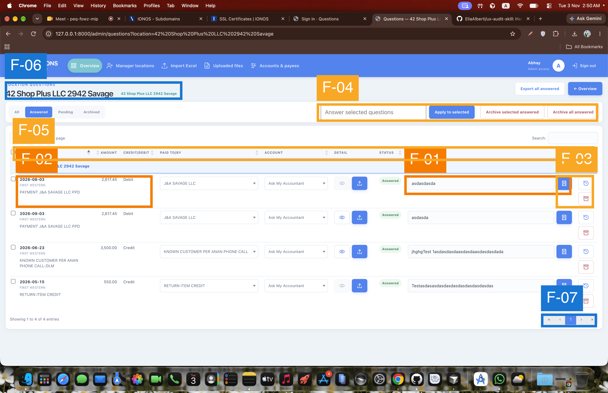

# UX Audit, Questions Workspace: Row-by-row answering

## Executive Summary

The screen supports efficient bulk and row-level accounting work, but its hierarchy does not match the primary goal of answering questions. The transaction description—the content that explains what must be answered—is visually subordinate to date and bank metadata, while answered rows expose filled answer fields without clarifying whether Save will replace, update, or add another response. Mixed-experience users must also learn five icon-only row actions. The highest-value changes are to promote the question context, make answer semantics explicit, and label or consolidate row actions.

## Scope & Method

- **Goal evaluated:** Review accounting transactions and answer each question in its row.
- **User type / platform:** First-time and returning administrators on desktop web.
- **Depth:** Full heuristic sweep.
- **Screens:**

| Step | File | Screen |
|---|---|---|
| 1 | `questions-answered.png` | Questions table filtered to Answered |

- **Frameworks applied:** Nielsen, Shneiderman, Gerhardt-Powals, Bastien & Scapin, behavioural laws, Fogg, Cialdini, Gestalt, Norman, Tognazzini, WCAG 2.1 static subset, and content heuristics.
- **Not assessable from this static screen:** focus visibility and order, keyboard and screen-reader behaviour, tooltips, confirmation dialogs, upload or save feedback, loading and latency, responsive reflow, zoom, motion, error states, and what Save does to an existing answer.

## Findings Overview

| ID | Sev | Screen | Check | Finding | Heuristics |
|---|---:|---|---|---|---|
| F-01 | 3 | Questions table | CTA-AMBIGUITY | Answered rows do not state whether Save updates, replaces, or adds an answer | Nielsen #2, #5; Norman: Mapping; Content #3 |
| F-02 | 3 | Questions table | HIERARCHY-FLAT | The question context is visually weaker than transaction metadata | Nielsen #2, #8; G-P #3, #8; Gestalt: Proximity |
| F-03 | 2 | Questions table | CTA-AMBIGUITY | Five repeated row actions rely on icons without visible labels | Nielsen #6; B&S: Significance of codes; Norman: Signifiers |
| F-04 | 2 | Answered toolbar | OVERLOAD | Answer, apply, and two archive operations compete in one control band | Nielsen #5, #8; Hick's Law; Gestalt: Proximity |
| F-05 | 2 | Questions table | CONTRAST-FAIL | Small pale metadata and headers may be difficult to scan | WCAG 1.4.3; B&S: Guidance/Legibility; Tog: Readability |
| F-06 | 1 | Page heading/table | OVERLOAD | The same location is repeated in the title, pill, and group row | Nielsen #8; G-P #10 |
| F-07 | 1 | Table controls | STATE-GAP | Pagination and page-size controls remain prominent for four records | Nielsen #8; G-P #8 |

## Screen-by-Screen

### Step 1: Questions table (`questions-answered.png`)

#### [S3] F-01 · Existing-answer behaviour is ambiguous

- **Check:** CTA-AMBIGUITY · **Heuristics:** Nielsen #2 and #5; Norman: Mapping; Content #3
- **Evidence:** The Answered filter is selected; every visible row carries an Answered status, a filled text field, and an icon-only Save control. No visible text explains whether editing and saving replaces the answer, updates it, or adds a follow-up.
- **Impact on goal:** Administrators working with financial records cannot predict the result of the primary row action. This creates hesitation and a credible risk of unintended answer history changes.
- **Recommendation:** Present saved answers as read-only content, then expose an explicit text action such as **Add follow-up** or **Edit answer**. If both behaviours exist, make them separate named actions and state the consequence before submission. · **Effort:** M

#### [S3] F-02 · The content being answered is visually buried

- **Check:** HIERARCHY-FLAT · **Heuristics:** Nielsen #2 and #8; G-P #3 and #8; Gestalt: Proximity
- **Evidence:** The first column is labelled Location, although the location is already shown in the group row. Within each transaction, the date is boldest, the bank name is secondary, and the transaction description appears in the smallest, palest text.
- **Impact on goal:** The administrator must search through metadata to find the actual transaction context before composing each answer. That tax repeats on every row and increases the chance of answering against the wrong cue.
- **Recommendation:** Rename the column to **Question / transaction**, make the description the primary line, and move date, bank, amount, and debit/credit into a compact secondary metadata line. Keep location only at the group level. · **Effort:** M

#### [S2] F-03 · Row actions depend on learned icon meanings

- **Check:** CTA-AMBIGUITY · **Heuristics:** Nielsen #6; Shneiderman #2; B&S: Significance of codes; Norman: Signifiers; Content #3
- **Evidence:** Each row repeats eye, upload, floppy-disk, history, and archive icons without visible action text. Several are visually similar square buttons, while their consequences differ substantially.
- **Impact on goal:** Returning users may learn the controls, but first-time users must infer or test them. Misidentifying Save, history, or archive interrupts a repetitive answering workflow and can lead to costly mistakes.
- **Recommendation:** Give the primary answer action a visible verb label. Group secondary actions under a labelled **More** menu, or pair each remaining icon with concise text. Do not rely on hover tooltips as the only label. · **Effort:** M

#### [S2] F-04 · Bulk answer and archive controls compete

- **Check:** OVERLOAD · **Heuristics:** Nielsen #5 and #8; Hick's Law; Gestalt: Proximity; Fogg: Ability
- **Evidence:** In the Answered view, the same horizontal band contains an answer input, Apply to selected, Archive selected answered, and Archive all answered. The destructive controls sit directly beside the answering control.
- **Impact on goal:** Users must repeatedly distinguish between adding answers and removing answered records from the active workspace. The proximity increases decision time and raises the cost of a slip.
- **Recommendation:** Keep the bulk answer control in All/Pending views. In Answered, move archive operations into a separate **Archive** group or overflow menu, with the scope stated after selection (for example, **Archive 3 selected**). · **Effort:** S

#### [S2] F-05 · Repeated secondary text appears faint and small

- **Check:** CONTRAST-FAIL (verify) · **Heuristics:** WCAG 1.4.3; B&S: Guidance/Legibility; Tog: Readability
- **Evidence:** Uppercase table headers, bank names, transaction descriptions, pagination labels, and metadata use small pale blue-grey text on white or very light grey surfaces.
- **Impact on goal:** The user must scan these values across every row. Weak legibility increases fatigue and makes the already-deprioritised transaction context harder to use.
- **Recommendation:** Verify these styles with a contrast checker at their rendered font sizes. Raise text contrast to at least 4.5:1 for normal text, use at least 12–14 px for repeated content, and reserve uppercase tracking for short labels rather than transaction data. · **Effort:** S

#### [S1] F-06 · Location context is repeated three times

- **Check:** OVERLOAD · **Heuristics:** Nielsen #8; G-P #10
- **Evidence:** “42 Shop Plus LLC 2942 Savage” appears as the page title, an adjacent pill, and the expanded table group label.
- **Impact on goal:** The repetition consumes attention and vertical space without adding a new distinction on this single-location screen.
- **Recommendation:** Keep the page title and group label, or the page title and pill, but not all three. Use the pill only when multiple locations are active. · **Effort:** S

#### [S1] F-07 · Table chrome does not adapt to the four-record state

- **Check:** STATE-GAP · **Heuristics:** Nielsen #8; G-P #8
- **Evidence:** The table visibly contains four entries, yet displays a 50-entries selector, global search, and a five-button pagination control with only page 1 available.
- **Impact on goal:** These inactive controls add visual noise around the transaction rows, though they do not block answering.
- **Recommendation:** Hide pagination when results fit on one page and suppress the page-size selector below its smallest threshold. Keep search only if filtering four current results is still useful. · **Effort:** S

## Journey-Level Findings

Only one screen was supplied, so cross-screen consistency, multi-step progress, and the final journey state cannot be evaluated. On this screen, the Fogg diagnosis is: the prompt to answer is visible, but **ability** is taxed by weak question hierarchy and ambiguous answer/action semantics. Motivation is neutral; the UI communicates administrative function but offers no visible completion feedback or remaining-work cue in the captured Answered state. The Peak-End Rule cannot be assessed without the completion or confirmation state.

## What Works (keep)

- **P-01:** Answered status uses both text and colour, so state is not communicated by colour alone (WCAG 1.4.1; G-P #9).
- **P-02:** Destructive archive controls are consistently red while answer/save controls are blue, supporting recognition and error prevention (Nielsen #4 and #5).
- **P-03:** Location grouping and row selection support repetitive expert workflows (Nielsen #7; B&S: Adaptability).
- **P-04:** Filters, search, and bulk operations provide useful efficiency paths for larger datasets (Shneiderman #2; Nielsen #7).

## Prioritised Recommendations

1. **Clarify answer semantics:** replace the editable saved-answer field with an explicit **Add follow-up** or **Edit answer** path (F-01).
2. **Promote the question context:** lead each row with the transaction description and demote date/bank metadata (F-02).
3. **Reduce action ambiguity:** label the primary action and consolidate secondary icons; separate bulk archive from bulk answering (F-03, F-04).
4. **Quick polish:** verify contrast, remove redundant location labels, and hide irrelevant pagination controls (F-05 to F-07).

## Framework Coverage

| Framework | Findings |
|---|---|
| Nielsen | F-01, F-02, F-03, F-04, F-06, F-07 |
| Shneiderman | F-03; feedback and closure not assessable statically |
| Gerhardt-Powals | F-02, F-06, F-07 |
| Bastien & Scapin | F-03, F-05 |
| Hick's Law | F-04 |
| Fitts's Law | No visible target-size issue established from this screenshot |
| Miller's Law | F-02, F-03 |
| Jakob's Law | F-01, F-03 |
| Peak-End Rule | Not assessable from a single in-progress screen |
| Fogg Behaviour Model | F-01, F-02, F-04 |
| Cialdini | No relevant persuasion or dark-pattern finding |
| Gestalt | F-02, F-04 |
| Norman | F-01, F-03 |
| Tognazzini | F-02, F-03, F-05 |
| WCAG 2.1 static subset | F-05; P-01 |
| Content design | F-01, F-03 |

## Sources

Nielsen: nngroup.com/articles/ten-usability-heuristics · Shneiderman: cs.umd.edu/users/ben/goldenrules.html · Gerhardt-Powals: Int. J. HCI (1996) · Bastien & Scapin: INRIA RT-0156 (1993) · Laws: lawsofux.com · Fogg: behaviormodel.org · Cialdini: influenceatwork.com · Norman: jnd.org · Tognazzini: asktog.com/atc/principles-of-interaction-design · WCAG: w3.org/WAI/WCAG21/quickref · Content design: contentdesign.london
